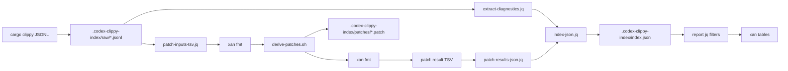

# Cargo Clippy Index Scripts

This directory contains the executable command surface and data-shaping filters for the `cargo-clippy-index` skill.
Use `Justfile` recipes instead of invoking the lower-level scripts directly unless you are testing a single pipeline stage.

## Pipeline



The important boundary is that jq owns JSON extraction, grouping, report shaping, and final `index.json` assembly.
Xan owns TSV and CSV delimiter conversion, JSON-to-CSV conversion, and markdown table rendering.
Shell, coreutils, diff, and git own filesystem patch derivation from xan-normalized rows.

## Command Surface

| File                                     | Role                                                                                           |
| ---------------------------------------- | ---------------------------------------------------------------------------------------------- |
| [Justfile](./Justfile)                   | Orchestrates all indexing, patch derivation, and report rendering recipes.                     |
| [derive-patches.sh](./derive-patches.sh) | Reads normalized patch-input rows, writes patch files, and emits normalized patch-result rows. |

`Justfile` uses `set no-cd`, so `root="."` resolves relative to the directory where `just` was invoked.
The recipes intentionally keep shell logic thin and delegate JSON work to jq filters.

The main recipes are:

| Recipe              | Purpose                                                                          |
| ------------------- | -------------------------------------------------------------------------------- |
| `sweep`             | Run `cargo clippy` package by package and write raw JSONL logs.                  |
| `sweep-fix`         | Run the package sweep with `cargo clippy --fix --allow-dirty`.                   |
| `diagnostics-jsonl` | Extract diagnostic rows from raw Cargo JSONL logs.                               |
| `patch-inputs-tsv`  | Extract replacement spans as TSV rows for the shell patch tool.                  |
| `patch-results-tsv` | Derive patch files and print patch result rows.                                  |
| `index-json`        | Assemble `.codex-clippy-index/index.json` from jq diagnostics and patch results. |
| `index`             | Rebuild `index.json` and `todo.tsv`.                                             |
| `patches`           | Rebuild `index.json`, `todo.tsv`, and `.patch` files.                            |
| `patches-md`        | Render the patch manifest for review.                                            |
| `table`             | Render residual diagnostics as markdown tables.                                  |

Run the full patch-aware rebuild from a Rust workspace with:

```bash
just -f /path/to/cargo-clippy-index/scripts/Justfile patches .
```

Review generated patches with:

```bash
just -f /path/to/cargo-clippy-index/scripts/Justfile patches-md .
```

## JSON Filters

| Filter                                                   | Input                                 | Output              | Purpose                                                       |
| -------------------------------------------------------- | ------------------------------------- | ------------------- | ------------------------------------------------------------- |
| [workspace-packages.jq](./workspace-packages.jq)         | `cargo metadata` JSON                 | Package names       | Select sorted workspace package names.                        |
| [extract-diagnostics.jq](./extract-diagnostics.jq)       | Slurped Cargo JSONL array             | JSONL diagnostics   | Extract diagnostic fields and suggestion metadata.            |
| [patch-inputs-tsv.jq](./patch-inputs-tsv.jq)             | Slurped Cargo JSONL array             | TSV rows            | Flatten replacement spans for patch derivation.               |
| [patch-results-json.jq](./patch-results-json.jq)         | Patch-result TSV                      | JSON array          | Convert patch results into structured rows.                   |
| [index-json.jq](./index-json.jq)                         | Diagnostic JSON and patch-result JSON | `index.json` object | Merge diagnostics with patch status and manifest rows.        |
| [todo-json.jq](./todo-json.jq)                           | `index.json`                          | JSON array          | Shape stable todo rows for `todo.tsv`.                        |
| [patches-json.jq](./patches-json.jq)                     | `index.json`                          | JSON array          | Shape patch manifest rows for CSV or markdown rendering.      |
| [multiple-versions-json.jq](./multiple-versions-json.jq) | `index.json`                          | JSON array          | Group `clippy::multiple_crate_versions` residual diagnostics. |
| [residual-summary-json.jq](./residual-summary-json.jq)   | `index.json`                          | JSON array          | Group non-dependency residual diagnostics.                    |

All filters should produce structured JSON unless their name explicitly says `tsv`.
Add new report shaping as jq filters, then call them from thin Just recipes.

## Patch Tool Contract

`derive-patches.sh <root>` reads unit-separator rows from standard input.
The Justfile converts this contract to and from TSV with `xan fmt`.
The logical input header is:

```tsv
suggestion_key	applicability	replacement_count	replacement_index	file_name	byte_start	byte_end	replacement_base64
```

`patch-inputs-tsv.jq` base64-encodes replacement text so tabs and newlines survive the table boundary.
`xan fmt` converts the TSV rows to unit-separator rows before the shell script reads them.
The shell script groups rows by `suggestion_key`, validates replacement spans, applies replacements with byte-slicing primitives, writes patches under `.codex-clippy-index/patches/`, computes ids with `git patch-id --stable`, and prints unit-separator patch results.
`xan fmt` converts the patch results back to TSV before jq reads them.

The output header is:

```tsv
suggestion_key	id	status	reason	path	files
```

The `status` value is `written` when a patch file was created.
The `status` value is `skipped` when a suggestion cannot be safely converted into a patch.

Common skip reasons are:

| Reason                          | Meaning                                                                 |
| ------------------------------- | ----------------------------------------------------------------------- |
| `non-machine-applicable`        | Clippy did not mark the suggestion as `MachineApplicable`.              |
| `missing-span-data`             | A replacement row is missing a file, byte span, or replacement payload. |
| `overlapping-spans`             | Multiple replacements for the same file overlap.                        |
| `missing-file`                  | The target file does not exist under the workspace root.                |
| `non-utf8-file`                 | The target file cannot be decoded as UTF-8.                             |
| `invalid-byte-span`             | A span has negative or reversed byte offsets.                           |
| `byte-span-out-of-range`        | A span extends past the target file contents.                           |
| `replacement-produces-non-utf8` | Applying the replacement would produce invalid UTF-8.                   |
| `empty-patch`                   | The replacement does not change any file contents.                      |

Patch ids come from `git patch-id --stable` over the generated patch text.
Patch files are ordinary unified diffs and should pass `git apply --check`.

## Data Products

| Path                                       | Producer               | Purpose                                                 |
| ------------------------------------------ | ---------------------- | ------------------------------------------------------- |
| `.codex-clippy-index/raw/<package>.jsonl`  | `sweep` or `sweep-fix` | Raw Cargo JSON messages for one package.                |
| `.codex-clippy-index/raw/<package>.stderr` | `sweep` or `sweep-fix` | Non-JSON Cargo stderr for one package.                  |
| `.codex-clippy-index/status.tsv`           | `sweep` or `sweep-fix` | Package exit codes and exact commands.                  |
| `.codex-clippy-index/patches/<id>.patch`   | `derive-patches.sh`    | Reviewable patch for one machine-applicable suggestion. |
| `.codex-clippy-index/index.json`           | `index-json`           | Aggregated diagnostics and patch manifest.              |
| `.codex-clippy-index/todo.tsv`             | `index` or `patches`   | Stable todo rows for agent planning.                    |

Raw JSONL logs are the durable source of truth.
Derived files should be regenerated rather than edited by hand.

## Development Notes

Keep JSON parsing and assembly in jq.
Use `xan fmt`, `xan from`, and `xan to` for TSV, CSV, and markdown table operations whenever possible.
Keep `derive-patches.sh` focused on byte-span validation, file reads, diff generation, `git patch-id --stable`, and normalized patch result output.
Keep Just recipes discoverable with comments because `just --list` uses those comments.
Justfile updates are justified when a repeated workflow step needs to become part of the skill command API.
